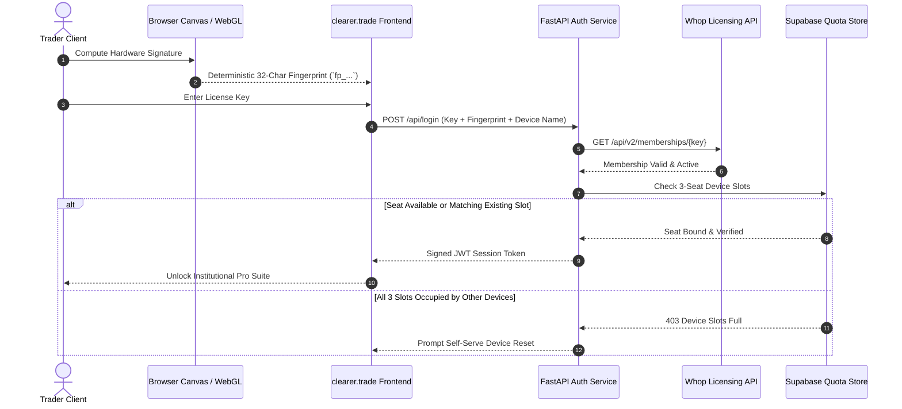

# Archived: Hardware Fingerprinting & Whop DRM Subsystem

> **Note**: This directory contains the original proprietary DRM, hardware fingerprinting, and Whop licensing architecture used prior to open-sourcing clearer.trade. It is preserved here as a reference implementation for builders looking to implement client-side canvas/WebGL hardware signatures, seat-based device limits, and merchant-of-record webhook automation.

---

## 🏛️ Architectural Overview

The licensing system was built to solve a unique problem for desktop/web SaaS products: **preventing license key sharing across multiple traders while avoiding false lockouts when users switch VPNs, public WiFi, mobile cellular hotspots, or home networks.**

Rather than tracking volatile user IP addresses, the platform implemented **Client-Side Hardware Fingerprinting** combined with a **3-Seat Concurrent Device Manager**.



---

## 🧩 Components in this Archive

### 1. `fingerprint.ts` — Deterministic Hardware Signature Generator
- **Canvas 2D Rendering Engine**: Draws text with fractional offsets (`125, 1`, `4, 17`) and RGBA alpha gradients (`rgba(102, 204, 0, 0.7)`). Because each GPU model, display driver, and OS renders subpixel antialiasing with minute mathematical variances, the resulting canvas image data URL produces a consistent machine-specific signature.
- **WebGL Hardware Unmasking**: Uses the WebGL `WEBGL_debug_renderer_info` extension to query the physical GPU renderer string (e.g., `ANGLE (NVIDIA, NVIDIA GeForce RTX 3080 Direct3D11 vs_5_0 ps_5_0)`).
- **Display & Concurrency Profile**: Combines screen resolution, color depth, CPU concurrency (`navigator.hardwareConcurrency`), and client timezone.
- **Hash Compression**: Derives an indexed 32-character hexadecimal fingerprint stored in local session cache.

### 2. `DeviceManagerModal.tsx` — Self-Serve 3-Seat Slot Manager
- Provides an authenticated UI where traders can view all 3 device seats assigned to their license key.
- Identifies the current device with an active badge.
- Implements self-serve device unbinding with a 7-day cooldown guard to prevent rotating keys between different parties.

### 3. `LoginModal.tsx` — License Activation Flow
- Intercepts unauthenticated users.
- Connects directly to `/api/login` passing the hardware fingerprint header `X-Instance-Name`.
- Offers a 1-click Demo Preview bypass for prospective traders.

### 4. `whitelist.py` — Backend Verification & Supabase Sync
- Connects to the Whop API (`https://api.whop.com/api/v2/memberships/{key}`) with Bearer authentication.
- Validates active status (`valid`, `active`, `past_due`).
- Enforces 3 distinct device slots in Supabase Postgres or local SQLite database.
- Implements HMAC-SHA256 signature verification for webhooks.

### 5. `test_device_reset.py`, `test_whop_webhook.py` & `test_keepalive.py`
- Test suites validating atomic slot reassignments, duplicate fingerprint prevention, cooldown periods, credit-pack webhook payloads, and database keepalive heartbeats.

### 6. `supabase_keepalive.py`
- Background poller and GitHub Actions keepalive script used to maintain active Postgres WAL transactions on Supabase free-tier database instances.

---

## 🔬 Technical Deep-Dive: Hardware & Canvas Fingerprinting vs. IP/Cookie Tracking

When architecting seat enforcement for desktop and web trading applications, SaaS developers typically evaluate three mechanisms: **IP Address Tracking**, **HTTP Cookies / LocalStorage Tokens**, or **Client-Side Hardware Fingerprinting**.

The table below contrasts why traditional methods fail for professional financial tooling, and why deterministic Canvas 2D + WebGL hashing was chosen:

| Metric / Scenario | IP Address Tracking | HTTP Cookies / LocalStorage | Canvas 2D + WebGL Hardware Hashing |
| :--- | :--- | :--- | :--- |
| **VPN & Proxy Resilience** | ❌ **High False Lockouts**: Traders constantly toggle VPNs (NordVPN, Mullvad, WireGuard) to reduce latency or protect their identity, triggering instant seat invalidation. | ✅ **Unaffected**: Session persists regardless of gateway network. | ✅ **Unaffected**: Hardware renderer and floating-point math remain identical across network hops. |
| **Mobile Hotspots & Dynamic ISPs** | ❌ **High Volatility**: Cellular LTE/5G carrier IPs and residential broadband dynamic IPs cycle daily or hourly. | ✅ **Unaffected**: Storage survives IP reassignments. | ✅ **Unaffected**: Device hardware signature does not change across networks. |
| **Shared Networks & CGNAT** | ❌ **IP Collisions**: Institutional trading desks, co-working offices, or university dorms share a single public IPv4 egress (Carrier-Grade NAT). Multiple users share one IP. | ✅ **Seat-Accurate**: Isolated to individual browser profiles. | ✅ **Seat-Accurate**: Uniquely distinguishes between distinct physical machines on the same LAN/subnet. |
| **Privacy & GDPR Compliance** | ⚠️ **Severe Liability**: Logging public IPs constitutes Personally Identifiable Information (PII) under GDPR and sparks immediate backlash in privacy-conscious trading communities. | ⚠️ Subject to ePrivacy Directive ("Cookie Law") and consent banners if used for cross-site or persistent tracking. | 🛡️ **Zero PII**: Generates an irreversible 32-character hexadecimal digest from hardware rendering variations. No IP addresses, names, or location data are logged. |
| **Incognito & Anti-Tracking Evasion** | ❌ Easy to bypass with residential proxy services or TOR. | ❌ **Trivially Evaded / Cleared**: Users routinely clear cache or use Incognito mode; tokens can also be exported and shared on Discord/Telegram. | 🔒 **Tamper-Resistant**: Canvas 2D subpixel font rasterization and WebGL driver strings execute consistently inside standard private browsing sessions. |
| **Account Sharing Deterrence** | ❌ Cannot distinguish between 1 traveling user vs. 5 people sharing a single key in the same city. | ❌ Zero friction to copy-paste authorization bearer headers. | ✅ **Hardware Bounded**: Restricts access to at most 3 distinct GPU/display hardware profiles simultaneously, backed by a 7-day unbind cooldown. |

---

### 🧮 The Mathematics of Canvas & WebGL Subpixel Divergence

Canvas fingerprinting works because modern browsers delegate graphics drawing directly to the underlying operating system and physical GPU:

1. **Subpixel Antialiasing Variances**:
   When drawing text across fractional coordinates:
   ```typescript
   ctx.fillRect(125, 1, 62, 20);
   ctx.fillText('clearer.trade, <canvas> 1.0', 2, 15);
   ctx.fillStyle = 'rgba(102, 204, 0, 0.7)';
   ctx.fillText('clearer.trade, <canvas> 1.0', 4, 17);
   ```
   The browser converts vector glyphs to raster pixels using OS-level rasterizers (e.g., DirectWrite on Windows, Core Text on macOS, FreeType on Linux). Subpixel hinting, font smoothing gamma curves, and floating-point rounding errors vary at the sub-pixel level between hardware architectures.

2. **WebGL Driver Signature Unmasking**:
   By querying the `WEBGL_debug_renderer_info` extension:
   ```typescript
   const debugInfo = gl.getExtension('WEBGL_debug_renderer_info');
   const renderer = gl.getParameter(debugInfo.UNMASKED_RENDERER_WEBGL);
   ```
   The application extracts the exact GPU pipeline string (such as `ANGLE (NVIDIA, NVIDIA GeForce RTX 4090 Direct3D11 vs_5_0 ps_5_0)` or `Apple M2 Max`), uniquely separating a trader's high-performance workstation from their travel MacBook.

3. **Deterministic Hash Compression**:
   The combined canvas data URL, WebGL renderer, display resolution (`width x height x colorDepth`), CPU logical cores (`navigator.hardwareConcurrency`), and client timezone are folded into a deterministic 32-character hexadecimal identifier (`fp_...`).

---

### 🛡️ Threat Model & Mitigations

- **Can users reset their devices if they upgrade hardware?**
  Yes. The self-serve `DeviceManagerModal.tsx` allows traders to unbind a retired machine. To prevent abuse (rotating 1 license key among 10 users sequentially), unbinding is throttled by a **7-day cooldown guard per slot**.
- **What about privacy-hardened browsers (e.g., Brave Farbling)?**
  Browsers that inject subtle pseudo-random noise into canvas readbacks will produce a shifting fingerprint per session. For these users, `fingerprint.ts` caches the first generated hash into `localStorage` (`cs_instance_fp`) to maintain session stability, while falling back to graceful error bypasses rather than hard lockouts.
- **Why was this archived instead of kept in the open-source release?**
  In open-source software, client-side DRM is fundamentally counterproductive: anyone compiling from source can strip DRM checks. Rather than maintaining an artificial paywall, `clearer.trade` transitioned to **100% free, pure BYOK (Bring Your Own Key)**, releasing the DRM suite as open educational research for other software builders.

